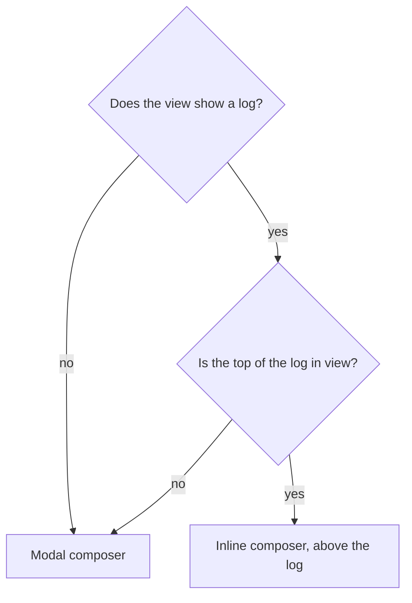

# Contributing

Thanks for helping! This guide explains how the extension is built and how to change it.

## Getting started

### Requirements

- Node 22+, pnpm 10 (`corepack enable`).
- Chrome 137+ or Firefox 129+: the first versions with Ed25519 in WebCrypto.

### Commands

```sh
pnpm install
pnpm test          # client and extension unit tests
pnpm lint          # Biome: formatting, imports and lint rules
pnpm format        # apply Biome's fixes
pnpm typecheck
pnpm build         # .output/chrome-mv3 and .output/firefox-mv3 in apps/extension
pnpm dev           # Chrome with hot reload
pnpm dev:firefox   # Firefox with hot reload
pnpm zip           # store-ready zips of both
```

Load a build by hand: `chrome://extensions` → Developer mode → **Load unpacked** → `apps/extension/.output/chrome-mv3`;
or `about:debugging#/runtime/this-firefox` → **Load Temporary Add-on** →
`apps/extension/.output/firefox-mv3/manifest.json`.

### Testing against a development server

By default, the extension talks to [dev-null.sh](https://dev-null.sh): trying it there publishes real commits. To try
it against a development /dev/null server instead, set its URL in a `.env` file:

```sh
cp apps/extension/.env.example apps/extension/.env
```

```sh
# apps/extension/.env
WXT_DEVNULL_URL=http://localhost:8000
```

Then run `pnpm dev`, or `pnpm build` and load the build by hand.

- **Optional.** Without `.env`, with `WXT_DEVNULL_URL` empty, or with a value that isn't an `http(s)` URL, the
  extension falls back on `https://dev-null.sh`: nothing breaks.
- **Fixed at build time.** WXT reads `.env` when it builds: change it, then restart `pnpm dev` or build again. Only the
  URL's origin is kept (scheme, host and port), and the manifest gets access to that server only, not to dev-null.sh.
- **Easy to tell apart.** A build for another server, like any `pnpm dev` build, is named **/dev/null (dev)** and has
  an amber icon (`public/icon-dev/`), on the extensions page and in the toolbar; its popup shows the server's host with
  a *dev* badge. Load it next to the store version if you like: each is its own extension, with its own key and
  session.
- **Its own account.** Sign in from the popup as usual: you approve the extension on the development server, with an
  account there. It needs the device sign-in (dev-null-sh/dev-null.sh#585), or the loopback fallback.
- **Never shipped.** `.env` is ignored by git and left out of the sources archive; CI and releases don't set
  `WXT_DEVNULL_URL`, so what users get always talks to dev-null.sh.

In the code, the server is `SERVER` from `apps/extension/src/lib/server.ts`: use it rather than writing
`https://dev-null.sh`. Tests always run against dev-null.sh; `test/dev-server.test.tsx` shows how to try code against
another server.

## How to contribute

### What to work on

[`TODO.md`](TODO.md) lists what the extension still lacks compared with dev-null.sh, in priority order. Pick work from
it in order, and check the item off in the commit that lands it. To propose something else, open an issue first.

### Workflow

- **One topic per pull request**, made of small, atomic commits.
- **Test first.** Write a failing test, make it pass, then clean up. When a change can't be test-driven (configuration,
  documentation), say so in the pull request.
- Before pushing, run `pnpm lint`, `pnpm test`, `pnpm typecheck` and `pnpm build`.
- Check the change in a real browser, on both GitHub markups (signed in and signed out) and in the light and dark
  themes.
- Open pull requests as drafts, targeting `main`.

### Commits

Commit titles follow [Conventional Commits](https://www.conventionalcommits.org/), in English, with the package as the
scope: `feat(extension): attach images to a commit`, `fix(client): …`, `docs: …`. The body explains why; the code
shouldn't need comments for that.

### Code

- TypeScript, strict. Code, identifiers and comments are in English.
- Formatting and lint rules are [Biome](https://biomejs.dev)'s (`biome.json`). Silence a rule only with a
  `biome-ignore` comment that says why.
- Comment only what the code can't say: a constraint from GitHub, WXT or /dev/null, a non-obvious choice.
- `packages/client` stays free of DOM and extension APIs.
- Everything that depends on GitHub's markup goes in `apps/extension/src/lib/github/`.
- Diagrams in the docs use [Mermaid](https://mermaid.js.org).

### Tests

Unit tests run with [Vitest](https://vitest.dev); component tests add `// @vitest-environment happy-dom` and render
with Preact's `act`. A component that waits for the background (mocked through `src/lib/messages.ts`) often needs one
more `await act(async () => {})` before asserting.

### Privacy

The extension talks to dev-null.sh and api.github.com only, and has no telemetry. Keep it that way: a new host, a new
permission or anything leaving the browser must be discussed in an issue first.

## Architecture

### Layout

| Path | What |
| --- | --- |
| `packages/client` | The /dev/null client in plain TypeScript, with no DOM or extension API: SSHSIG signatures on WebCrypto Ed25519, signed requests, the API calls, and the two sign-in flows. Runs anywhere WebCrypto and `fetch` do. |
| `apps/extension` | The extension ([WXT](https://wxt.dev), Preact, Tailwind CSS v4), for Chrome and Firefox (Manifest V3 for both). |
| `apps/extension/src/entrypoints` | The background (session, keys, every call to /dev/null), the content script on github.com, and the popup. |
| `apps/extension/src/components` | The Preact components: logs, composers, share buttons, popup screens. |
| `apps/extension/src/lib` | Everything else: GitHub's markup, settings, additions, images, messages to the background. |

Content scripts never call /dev/null: they ask the background (`ask` in `src/lib/messages.ts`), which holds the key
and signs. Messages are JSON, so images travel as base64.

### How signing works

There is no shell-out and no native binary. The background generates an Ed25519 key with WebCrypto, **not
extractable**, and keeps the `CryptoKeyPair` in the extension's IndexedDB. Each signed request carries the headers
`App\Services\SignedRequests` verifies: the message `"<timestamp>\n<nonce>\n<METHOD>\n<path and query>\n<body>"`,
signed in the SSHSIG format under the `devnull-api` namespace.

A commit with images is a multipart request, signed under the `devnull-api-images` namespace, with the images'
SHA-256 (hex, comma-separated) on a line before the payload.

`packages/client/test/fixtures/ssh-keygen-ed25519.json` was made once with `ssh-keygen -Y sign` on a test-only key.
Ed25519 is deterministic, so the TypeScript signer must produce that signature byte for byte, and the tests check it.

### How sign-in works

The key is approved as one of the user's /dev/null **devices** (Settings → Devices). It doesn't go on GitHub.

1. **Device grant** (dev-null-sh/dev-null.sh#585): `POST /api/v1/device-authorizations`, the user approves the code
   on `dev-null.sh/activate`, and the background polls `POST /api/v1/devices` with the `device_code`
   (`authorization_pending`, `slow_down`, `access_denied`, `invalid_grant`).
2. **Fallback, until #585 is merged**: when the start endpoint answers 404, `/mobile/authorize` with PKCE and a
   loopback `redirect_uri` (`http://127.0.0.1:<port>/…`, which /dev/null accepts per RFC 8252). Nothing listens on the
   port: the background catches the navigation with `webNavigation`, which is an **optional** permission asked for
   only at that moment, then closes the tab.

Disconnecting revokes the device on /dev/null, then deletes the key.

### Where it touches GitHub

Everything that depends on GitHub's markup is in `apps/extension/src/lib/github/`:

- `page.ts` reads the page from the URL, with `meta[name="hovercard-subject-tag"]` telling an organization from a
  user, and the issue or pull request title from `document.title`.
- `anchors.ts` lists, for each place the extension attaches, selectors from the most to the least specific, and
  answers with a selector, never an element, as WXT requires.
- `navigation.ts` tells when to read the page again: after Turbo renders it, since WXT's location change fires before.

GitHub serves two markups: signed out, the organization tabs are in the organization's header; signed in, they are a
Primer React `UnderlineNav` in the global header, which React may render again at any time. UIs are therefore kept
mounted by `src/lib/keep-mounted.ts`, which watches the mounted element rather than its anchor. They live in a Shadow
DOM, styled with Tailwind mapped onto Primer's CSS variables (`src/assets/tailwind.css`): GitHub's light, dark and
high-contrast themes apply with no code. The organization tab is the exception: it sits in GitHub's own tab list and
copies its neighbours' classes.

Things that will bite you:

- WXT resets the shadow host with `:host { all: initial !important }`: style the host from inside the shadow root.
- WXT 0.21 moves Tailwind's `@property` rules out of the shadow root, where they don't work.
- github.com's CSP only allows GitHub's hosts, `data:` and `blob:` as image sources: the background fetches /dev/null's
  images and hands them over as data URLs; local images (the composer's) use blob URLs.

Each decoration can be turned off from the popup's settings (`src/lib/settings.ts`): a new decoration is a new entry in
`FEATURES`, on by default.

### UI principles

The extension looks like GitHub and speaks like /dev/null: Primer's components, layout and colours, with /dev/null's
features and vocabulary (a *commit*, the *log*, *star*, *reply*, the `//` glyph and lanes). When in doubt, do what
dev-null.sh does.

#### Where the composer opens



- **A log at its top**: the composer is inline, above the log, like GitHub's comment box above a timeline.
- **A log scrolled down**: the log's header stays at the top of the screen, and a *Commit* button shows up in it to
  open the composer in a modal, so writing never scrolls the reader away from where they are. While the inline
  composer is in view, the header has no *Commit* button: there is one way to commit at a time. The header's last
  item never moves, so a button showing up or going away shifts nothing.
- **No log** (the share button on a repository, an issue or a pull request): the composer is modal.

The inline composer is GitHub's comment box with /dev/null's essentials: *Write* and *Preview* tabs, the character
count against /dev/null's limit, and a *Commit* button. The modal composer is dev-null.sh's: the author's avatar beside
the text, the tools below it.

#### What the composer adds to a commit

The extension may add to a commit what the user did not write: the GitHub page's link, the organization's mention,
and more to come. These are **additions** (`apps/extension/src/lib/additions.ts`):

- an addition is a piece of text with a label, a **reason** it can tell the user, and a pattern to find it;
- **sources** propose them from the composer's context (the page, the organization); a new idea is a new source,
  listed in `SOURCES`, and no composer changes;
- **nothing is added by default**: like an image, the user inserts an addition from the composer's toolbar, as
  GitHub's editor inserts a link or a mention: one button per kind, a menu to choose from when a kind has several
  (the author and the organization). It goes in at the caret, as an edit they can undo (Cmd+Z); a dot on its button,
  a check in its menu, says it is already in the text, typed by hand too. A composer opens empty, its placeholder
  showing;
- **the text is the only truth**: the body is the text, and the counter and the preview show exactly what is sent;
- an addition can say what leaving it out would mean (`missing`): written from an organization's log without its
  mention, the composer warns that the commit won't show there, with a way to insert it. The user decides.

## Continuous integration and releases

- **CI** (`.github/workflows/ci.yml`): every push to `main` and every pull request is linted, typechecked, tested and
  built.
  The run keeps the Chrome and Firefox archives for 14 days, to try the build.
- **Release** (`.github/workflows/release.yml`): pushing a `vMAJOR.MINOR.PATCH` tag sets the extension's version from
  the tag, checks and builds it, then publishes a GitHub release with three archives: Chrome, Firefox, and the sources
  Firefox Add-ons asks for.

  ```sh
  git tag v1.2.3 && git push origin v1.2.3
  ```

- **Chrome Web Store** (`.github/workflows/chrome-web-store.yml`): run it by hand from the Actions tab with a released
  tag. It builds the Chrome archive of that version and checks its manifest against the store's rules (version,
  128×128 icon, description of 132 characters at most, no `key`). The run's summary lists the permissions to justify on
  the store. Download the `chrome-web-store-<tag>` artifact, unzip it once, and upload the archive inside on the
  developer dashboard.

Workflows share `.github/actions/setup`, and every action is pinned to a commit.

## Before publishing anywhere

- Firefox requires `data_collection_permissions` in `browser_specific_settings.gecko` for new add-ons: decide what to
  declare (the extension sends what the user writes to dev-null.sh, and owner names to api.github.com).
- The Gecko id `dev-null-ext@jubianchi.fr` can't change once the add-on is published: confirm it before.
- Add the Playwright run against github.com (Chrome) and a `web-ext` smoke test (Firefox).

## Supply chain

`pnpm-workspace.yaml` sets `minimumReleaseAge` to 14 days and lets no dependency run install scripts except
`esbuild`. Think twice before adding a dependency.
