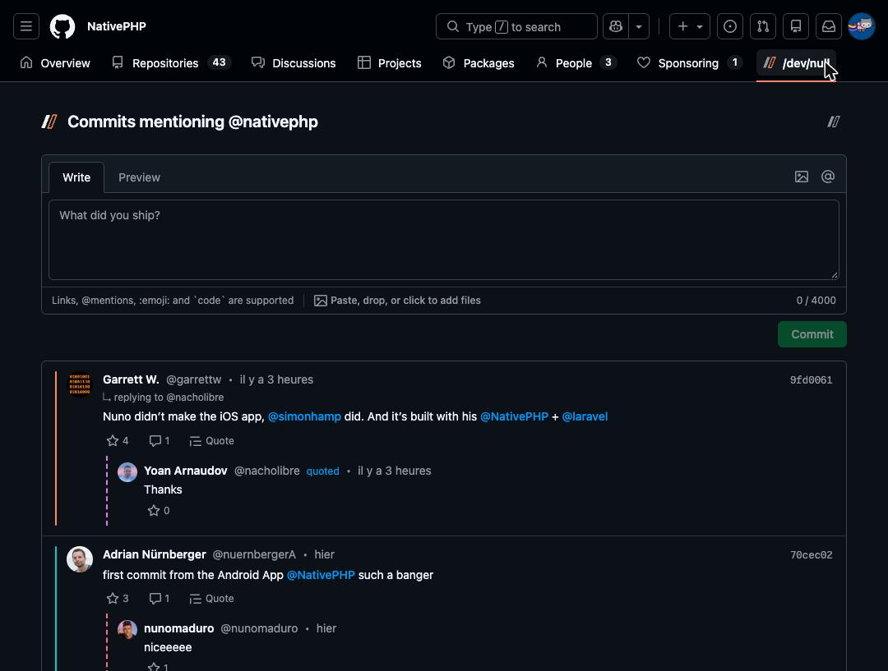
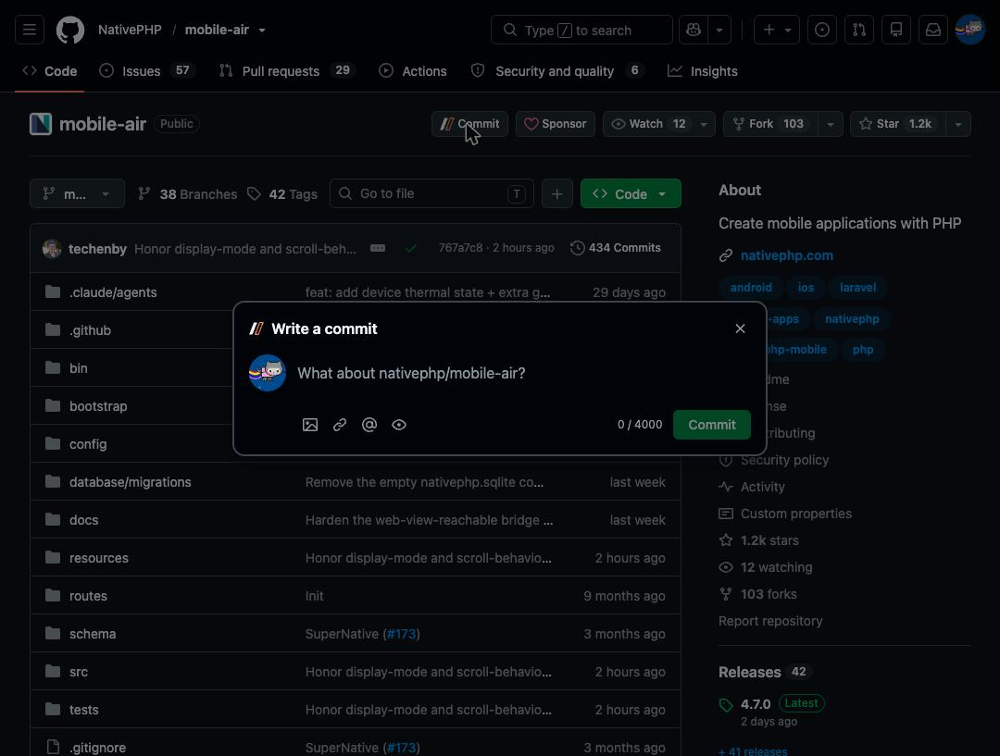
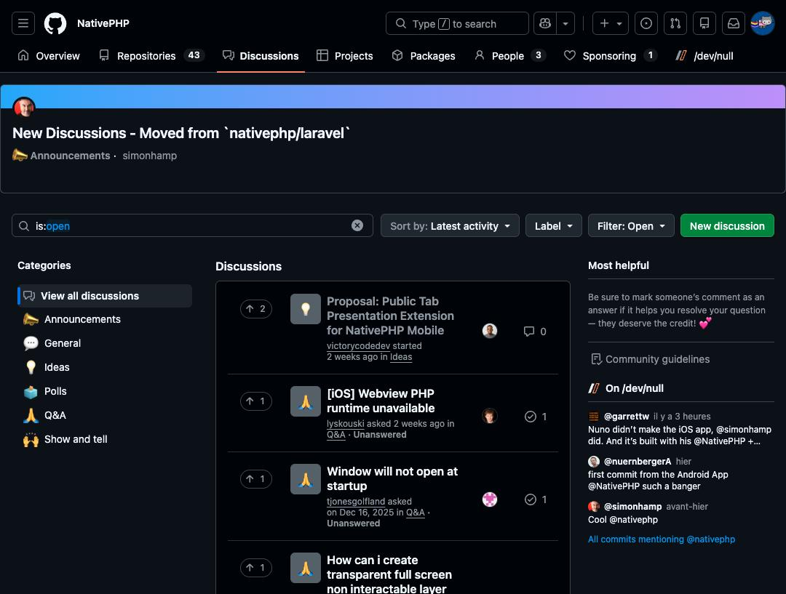

# dev-null-ext

**/dev/null**, the browser extension: it brings [/dev/null](https://dev-null.sh) to the sites developers work on. For
now, it makes /dev/null feel like a GitHub feature: read what developers ship about an organization, and commit about
what you're looking at, without leaving GitHub.

It looks like GitHub, in its light, dark and high-contrast themes, and speaks like /dev/null.

## What it adds to GitHub

### A /dev/null tab on organizations

Next to Repositories and People, the **/dev/null** tab shows the organization's log: every commit that mentions it,
as on dev-null.sh, with its images, quotes, link previews, replies and stars. Write a commit right above the log, with
*Write* and *Preview* tabs, as you would comment on an issue.

### A Commit button wherever there's something to share

On a **repository**, an **issue**, a **pull request**, a **discussion** or a **release**, a **Commit** button opens
/dev/null's composer, ready to share the page:

- insert the page's link, the author's mention or the organization's mention from the toolbar, or type `@` to pick
  one; nothing is added unless you choose to;
- attach up to 3 images, each with a description for people who can't see it;
- preview the commit exactly as /dev/null will publish it.

### /dev/null next to discussions

An organization's discussions show the latest commits mentioning it, in an **On /dev/null** section next to GitHub's
own.

### Follow people on /dev/null

Wherever GitHub lists people with a Follow button (an organization's **People**, a profile's **followers** and
**following**, a repository's **stargazers** and **watchers**), a /dev/null **Follow** button sits next to it, and
under it on a user's **profile**; it says Unfollow once you follow them. An **organization** can be followed the same
way, from its page, when it is on /dev/null. Someone who isn't on /dev/null yet says so once you try.

### Your profile and settings in the toolbar

The extension's popup shows your /dev/null profile, and lets you turn off anything the extension adds to GitHub.

## Install

The extension isn't on the Chrome Web Store or Firefox Add-ons yet. Download it from the
[latest release](https://github.com/jubianchi/dev-null-ext/releases/latest):

- **Chrome 137+** (and other Chromium browsers): unzip `dev-null-ext-<version>-chrome.zip`, open
  `chrome://extensions`, turn on **Developer mode**, then **Load unpacked** and pick the unzipped folder.
- **Firefox 129+**: the archive isn't signed yet, so Firefox only loads it until it restarts. Open
  `about:debugging#/runtime/this-firefox`, then **Load Temporary Add-on** and pick
  `dev-null-ext-<version>-firefox.zip`.

You can also build it from source, as described in [CONTRIBUTING.md](CONTRIBUTING.md#getting-started).

Then open the popup and **Join with GitHub**: already on /dev/null, you approve the extension as one of your devices on
dev-null.sh, as you would a phone. Disconnecting revokes it.

## Privacy

- Besides github.com, the extension talks to dev-null.sh, to read logs and publish your commits, and to
  api.github.com, to look up the owners of the pages you share. Nothing else, and no telemetry.
- Your key is generated in the browser and can't be read back, not even by the extension: it only signs.
- It only uses /dev/null's public API and its existing sign-in.

The details are in the [privacy policy](PRIVACY.md).

## Contributing

Bug reports and ideas are welcome in the issues. To work on the code, see [CONTRIBUTING.md](CONTRIBUTING.md); what's
next is in [TODO.md](TODO.md).

## License

[MIT](LICENSE)
