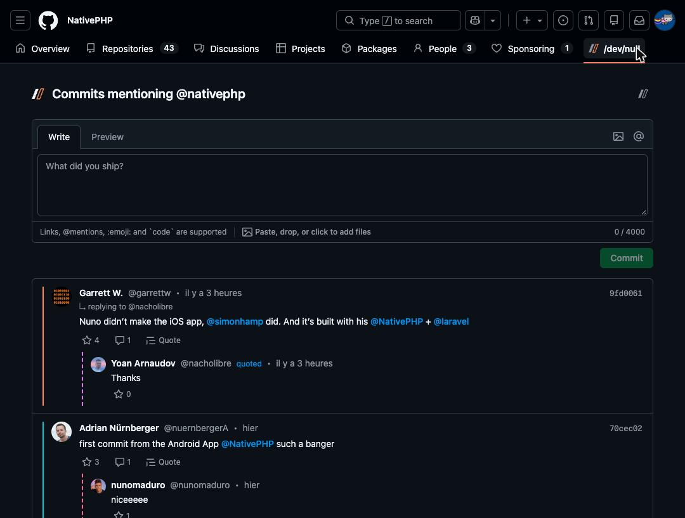
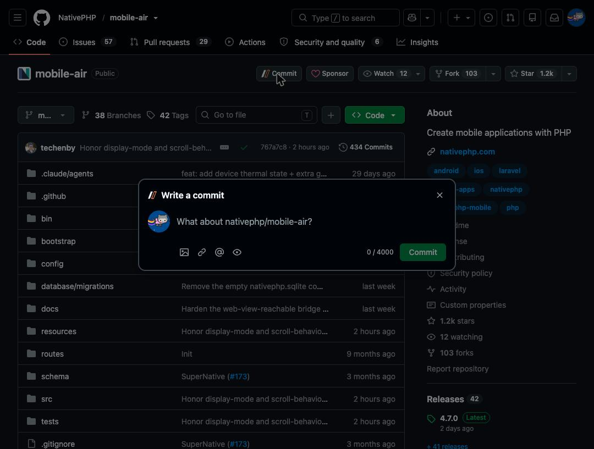
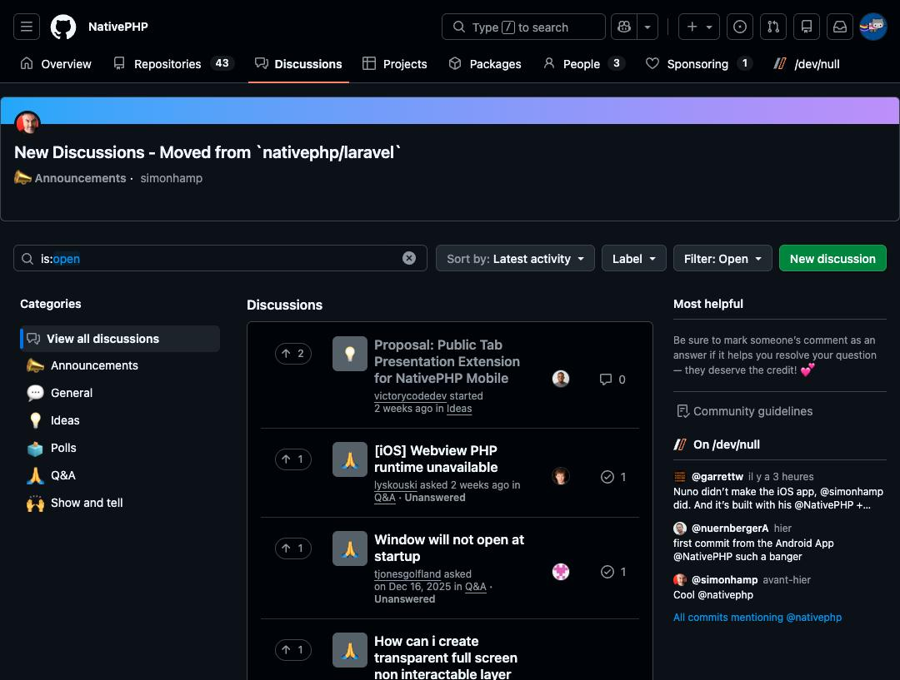
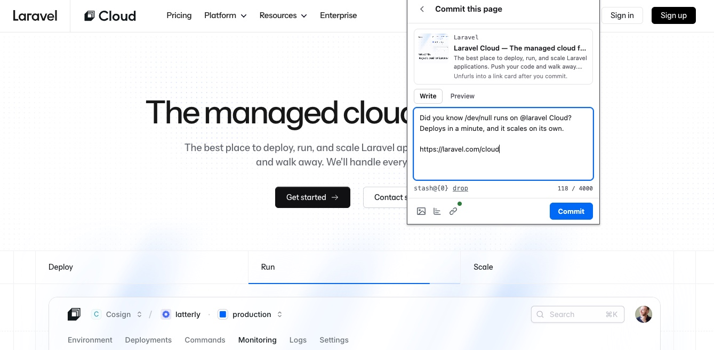
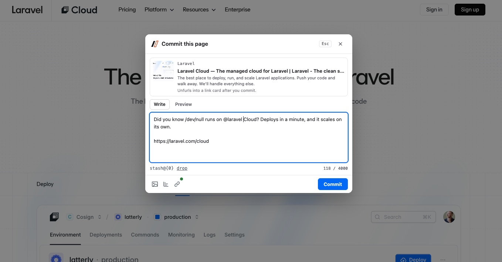

# dev-null-ext

**/dev/null**, the browser extension: it brings [/dev/null](https://dev-null.sh) to the sites developers work on. On
GitHub, it makes /dev/null feel like a GitHub feature: read what developers ship about an organization, and commit about
what you're looking at, without leaving GitHub. Anywhere else, share the article you're reading, with what you think of
it.

It looks like GitHub, in its light, dark and high-contrast themes, and speaks like /dev/null.

## What it adds to GitHub

### A /dev/null tab on organizations

Next to Repositories and People, the **/dev/null** tab shows the organization's log: every commit that mentions it,
as on dev-null.sh, with its images, polls, quotes, link previews, replies and stars. Write a commit right above the log, with
*Write* and *Preview* tabs, as you would comment on an issue.

### A Commit button wherever there's something to share

On a **repository**, an **issue**, a **pull request**, a **discussion** or a **release**, a **Commit** button opens
/dev/null's composer, ready to share the page:

- insert the page's link, the author's mention or the organization's mention from the toolbar, or type `@` to pick
  one; nothing is added unless you choose to;
- attach up to 3 images, each with a description for people who can't see it, or ask a question with a poll;
- preview the commit exactly as /dev/null will publish it.

### /dev/null next to discussions

An organization's discussions show the latest commits mentioning it, in an **On /dev/null** section next to GitHub's
own.

### Follow people on /dev/null

Wherever GitHub lists people with a Follow button (an organization's **People**, a profile's **followers** and
**following**, a repository's **stargazers** and **watchers**), a /dev/null **Follow** button sits next to it, and
under it on a user's **profile**; it says Unfollow once you follow them. An **organization** can be followed the same
way, from its page, when it is on /dev/null. Someone who isn't on /dev/null yet says so once you try.

### Your profile and settings in the toolbar

The extension's popup shows your /dev/null profile, and lets you turn off anything the extension adds.

## And on any page

### Commit the page you're reading

From the popup, **Commit this page** opens a composer on the page in your tab:

- its link is already there, without its tracking parameters (`utm_*`, `fbclid`…), and the card /dev/null will show
  is above the text: its image, title and description;
- text you selected on the page comes in as a quote;
- /dev/null is not a bookmark feed: **Commit** turns on once you've written 50 characters of your own, the link and
  the quote left out;
- a page that looks private (`localhost`, your network, a link with a token) gets a warning before you share it.

Once committed, the popup says so and closes.

### Alt+Shift+D, from the keyboard

On any page, **Alt+Shift+D** opens the same composer over the page, without reaching for the mouse. On GitHub, it
opens the page's own composer, or the organization log's. Change the shortcut in your browser's settings, or turn it
off in the extension's.

## Nothing you write is lost

Close a composer, or reload the page, and what you wrote comes back when you return, images included, as on
dev-null.sh: `stash@{0}`, with a way to `drop` it. A reply or a quote waiting this way shows `stash@{0}` on its
action.

## Install

- **Chrome 137+** (and other Chromium browsers): install it from the
  [Chrome Web Store](https://chromewebstore.google.com/detail/devnull/hokhoefheignhmakhfbccmlnkkfbnico).
- **Firefox 129+**: the extension isn't on Firefox Add-ons yet, and the archive isn't signed, so Firefox only loads it
  until it restarts. Download `dev-null-ext-<version>-firefox.zip` from the
  [latest release](https://github.com/jubianchi/dev-null-ext/releases/latest), open
  `about:debugging#/runtime/this-firefox`, then **Load Temporary Add-on** and pick the archive.

To try a release before it reaches the Chrome Web Store, unzip its `dev-null-ext-<version>-chrome.zip`, open
`chrome://extensions`, turn on **Developer mode**, then **Load unpacked** and pick the unzipped folder.

You can also build it from source, as described in [CONTRIBUTING.md](CONTRIBUTING.md#getting-started).

Then open the popup and **Join with GitHub**: already on /dev/null, you approve the extension as one of your devices on
dev-null.sh, as you would a phone. Disconnecting revokes it.

## Privacy

- Besides github.com, the extension talks to dev-null.sh, to read logs and publish your commits, and to
  api.github.com, to look up the owners of the pages you share. Nothing else, and no telemetry.
- Outside GitHub, it reads a page only when you ask, from the popup or with Alt+Shift+D, and only that page: its
  address, title, link card and the text you selected. The card's image loads from the site itself. Nothing leaves
  your browser until you commit.
- What you write stays in your browser until you commit or drop it, and is forgotten when you disconnect.
- Your key is generated in the browser and can't be read back, not even by the extension: it only signs.
- It only uses /dev/null's public API and its existing sign-in.

The details are in the [privacy policy](PRIVACY.md).

## Contributing

Bug reports and ideas are welcome in the issues. To work on the code, see [CONTRIBUTING.md](CONTRIBUTING.md); what's
next is in [TODO.md](TODO.md).

## License

[MIT](LICENSE)
