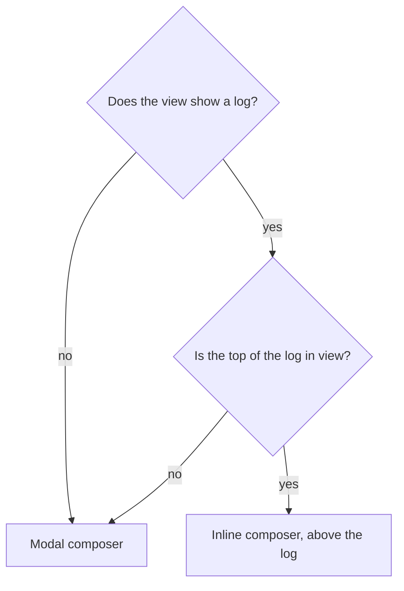

# /dev/null for GitHub

A browser extension that makes [/dev/null](https://dev-null.sh) feel like a GitHub feature:

- **Organization pages** get a `/dev/null` tab, next to Repositories and People, listing the commits that mention the
  organization (`GET /api/v1/organizations/{handle}/mentions`), with a composer to write one.
- **Repositories, pull requests and issues** get a **Commit** button that shares the page on /dev/null. The link
  renders as `owner/repo#123` with a card there, and a bare `@org` mention (on by default when the owner is an
  organization) files the commit under the organization's page.

It only uses /dev/null's public API and its existing sign-in. Nothing in /dev/null has to change.

> **Private.** Every package is `"private": true`, nothing is published to npm, the Chrome Web Store or AMO, and
> there is no telemetry.

## Layout

| Path | What |
| --- | --- |
| `packages/client` | The /dev/null client in plain TypeScript, with no DOM or extension API: SSHSIG signatures on WebCrypto Ed25519, signed requests, the API calls, and the two sign-in flows. Runs anywhere WebCrypto and `fetch` do. |
| `apps/extension` | The extension ([WXT](https://wxt.dev), Preact, Tailwind CSS v4), for Chrome and Firefox (Manifest V3 for both). |

## Requirements

- Node 22+, pnpm 10 (`corepack enable`).
- Chrome 137+ or Firefox 129+: the first versions with Ed25519 in WebCrypto.

## Commands

```sh
pnpm install
pnpm test          # client and extension unit tests
pnpm typecheck
pnpm build         # .output/chrome-mv3 and .output/firefox-mv3 in apps/extension
pnpm dev           # Chrome with hot reload
pnpm dev:firefox   # Firefox with hot reload
pnpm zip           # store-ready zips of both
```

Load a build by hand: `chrome://extensions` → Developer mode → **Load unpacked** → `apps/extension/.output/chrome-mv3`;
or `about:debugging#/runtime/this-firefox` → **Load Temporary Add-on** → `apps/extension/.output/firefox-mv3/manifest.json`.

## How signing works

There is no shell-out and no native binary. The background generates an Ed25519 key with WebCrypto, **not
extractable**, and keeps the `CryptoKeyPair` in the extension's IndexedDB. Each signed request carries the headers
`App\Services\SignedRequests` verifies: the message `"<timestamp>\n<nonce>\n<METHOD>\n<path and query>\n<body>"`,
signed in the SSHSIG format under the `devnull-api` namespace.

`packages/client/test/fixtures/ssh-keygen-ed25519.json` was made once with `ssh-keygen -Y sign` on a test-only key.
Ed25519 is deterministic, so the TypeScript signer must produce that signature byte for byte, and the tests check it.

## How sign-in works

The key is approved as one of the user's /dev/null **devices** (Settings → Devices). It doesn't go on GitHub.

1. **Device grant** (dev-null-sh/dev-null.sh#585): `POST /api/v1/device-authorizations`, the user approves the code
   on `dev-null.sh/activate`, and the background polls `POST /api/v1/devices` with the `device_code`
   (`authorization_pending`, `slow_down`, `access_denied`, `invalid_grant`).
2. **Fallback, until #585 is merged**: when the start endpoint answers 404, `/mobile/authorize` with PKCE and a
   loopback `redirect_uri` (`http://127.0.0.1:<port>/…`, which /dev/null accepts per RFC 8252). Nothing listens on the
   port: the background catches the navigation with `webNavigation`, which is an **optional** permission asked for
   only at that moment, then closes the tab.

Disconnecting revokes the device on /dev/null, then deletes the key.

## Where it touches GitHub

Everything that depends on GitHub's markup is in `apps/extension/src/lib/github/`:

- `page.ts` reads the page from the URL, with `meta[name="hovercard-subject-tag"]` telling an organization from a
  user, and the issue or pull request title from `document.title`.
- `anchors.ts` lists, for each place the extension attaches, selectors from the most to the least specific, and
  answers with a selector, never an element, as WXT requires.
- `navigation.ts` tells when to read the page again: after Turbo renders it, since WXT's location change fires before.

GitHub serves two markups: signed out, the organization tabs are in the organization's header; signed in, they are a
Primer React `UnderlineNav` in the global header, which React may render again at any time. UIs are therefore kept
mounted by `src/lib/keep-mounted.ts`, which watches the mounted element rather than its anchor. They live in a Shadow
DOM, styled with Tailwind mapped onto Primer's CSS variables (`src/assets/tailwind.css`): GitHub's light, dark and
high-contrast themes apply with no code. WXT 0.21 moves Tailwind's `@property` rules out of the shadow root, where they
don't work. The organization tab is the exception: it sits in GitHub's own tab list and copies its neighbours' classes.

## UI principles

The extension looks like GitHub and speaks like /dev/null: Primer's components, layout and colours, with /dev/null's
features and vocabulary (a *commit*, the *log*, *star*, *reply*, the `//` glyph and lanes).

### Where the composer opens



- **A log at its top**: the composer is inline, above the log, like GitHub's comment box above a timeline.
- **A log scrolled down**: the log's header stays at the top of the screen, and its *Commit* button opens the composer
  in a modal, so writing never scrolls the reader away from where they are.
- **No log** (the share button on a repository, an issue or a pull request): the composer is modal.

The inline composer is GitHub's comment box with /dev/null's essentials: *Write* and *Preview* tabs, the character
count against /dev/null's limit, and a *Commit* button. The modal composer is dev-null.sh's: the author's avatar beside
the text, the tools below it.

## Before publishing anywhere

- Firefox requires `data_collection_permissions` in `browser_specific_settings.gecko` for new add-ons: decide what to
  declare (the extension sends what the user writes to dev-null.sh, and owner names to api.github.com).
- The Gecko id `devnull-github@jubianchi.fr` is a placeholder.
- Add the Playwright run against github.com (Chrome) and a `web-ext` smoke test (Firefox).

## Supply chain

`pnpm-workspace.yaml` sets `minimumReleaseAge` to 14 days and lets no dependency run install scripts except
`esbuild`.
