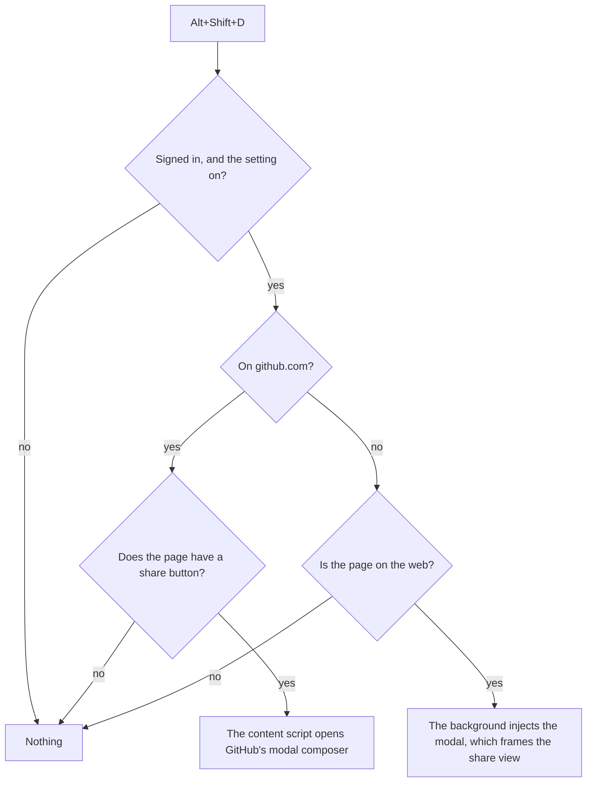
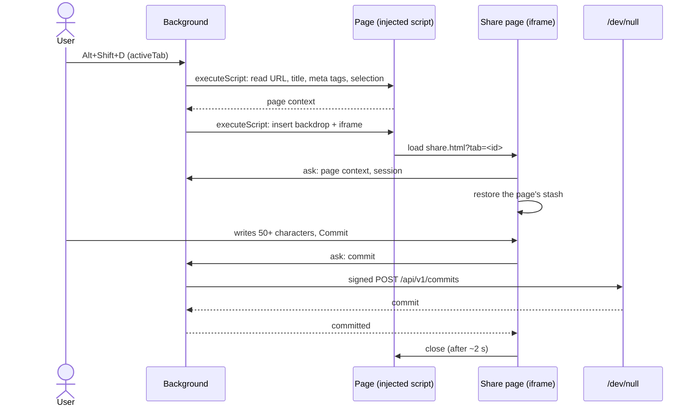

# Share any page

Commit about the page in the current tab, whatever the site: from the popup, or from a keyboard shortcut that opens
the composer over the page. The roadmap's items are in [TODO.md](../TODO.md#6-share-any-page).

## Principles

- **No automatic posts.** /dev/null is not a bookmark feed: a commit sharing a page says something about it. The
  composer requires **50 characters of the user's own words**: the text, less the page's link and the quoted lines
  (`>`). Mentions count. Until then, *Commit* is disabled and the composer says how many characters are still missing
  (e.g. "12 more characters to say what you think of it"). This is a nudge enforced by the extension only; /dev/null
  itself accepts a bare link.
- **The text is the only truth**, as in GitHub's composers: what the user sees in the text box is what is sent.
- **Nothing on GitHub changes.** Its share buttons and composers keep their behaviour, without the 50-character rule.

## The composer

### Additions

The share view uses the composer's [additions](../CONTRIBUTING.md#what-the-composer-adds-to-a-commit), with one
documented exception to "nothing is added by default":

| Addition | Inserted | Counts toward the 50 characters | Missing |
| --- | --- | --- | --- |
| The page's link | Yes, at the end of the text, the caret before it | No | Warns that the commit doesn't share the page, with a button to insert it again |
| The selected text | Yes, as a Markdown quote above the caret, when text was selected on opening | No | — |

Sharing the page is the very purpose of this view, so its link is there from the start; the user may still remove it,
as any other text. The toolbar keeps a button to insert it again, with the dot telling it is in the text.

### The link

Before it is inserted, the page's URL is cleaned:

- tracking parameters are removed (`utm_*`, `fbclid`, `gclid`, `mc_eid`, `igshid`, …): the user sees the cleaned URL;
- the fragment (`#…`) is kept: it often points at the relevant section.

The share view isn't offered on pages that aren't on the web: anything but `http:` and `https:` (`chrome://`,
`about:`, `file:`, extension pages, the browser's PDF viewer of a local file). The popup's button says why.

On a page that looks private, the composer warns, without blocking: `localhost`, private IP addresses, `*.local`,
`*.internal`, `*.lan`, single-label hosts (intranets), or a query with a secret-looking parameter (`token`, `key`,
`code`, `secret`, `password`, `session`, `auth`, `sig`).

### The page's card

Above the text, the composer shows the card /dev/null will unfurl: `og:title` (or the tab's title), `og:description`,
`og:image`, the site's name and domain, and "Unfurls into a link card after you commit." The extension reads these
`<meta>` tags from the page with `scripting`, under `activeTab`; the image loads in the extension's own page, outside
the site's CSP. When the page has none, the card shows the title and the domain.

### Tools

Write and Preview, mentions (`@`), images (up to 3) and polls, as in the other composers. Opening the file picker
closes the popup in some browsers: in the popup, attaching an image may need the modal (to check while building it).

### Stash

An unsent commit is a [stash](../CONTRIBUTING.md#stashes), as in the other composers, which matters all the more here
since the popup closes as soon as the user clicks elsewhere:

- **One stash per page**, named `page:<URL>` with the cleaned URL, as the share buttons on GitHub's pages name theirs.
  The popup and the modal of the same page share it.
- **Kept, restored and shown as everywhere else**: `stash@{0}` and `drop` in the counter row when it comes back;
  `Escape` or a click outside closes the modal and keeps it.

### Once committed

The view says "Committed", with a link to the commit on /dev/null, then closes by itself after about two seconds: the
popup with `window.close()`, the modal by asking the script that inserted it to remove it.

## Where it opens

### The popup

On the profile card, a **Commit this page** button opens the share view, which can go back to the card. It isn't shown
to guests, nor on github.com, where the page's own buttons share it; on a page that isn't on the web, it is disabled
and says why. When the page has a stash, the button shows `stash@{0}` in 11px ("You have an unsent commit about this
page"), as dev-null.sh's Reply and Quote actions do.

### The keyboard shortcut

`Alt+Shift+D` (`⌥⇧D` on macOS), a `commands` entry the user can change in `chrome://extensions/shortcuts` or in
Firefox's add-on settings. It does nothing for guests, nor when its setting is off (`FEATURES`, a new *Everywhere*
group).

Off GitHub, the modal is an `<iframe>` of the extension's share page, the same page as the popup's view, inserted by a
small script the background injects with `scripting`, under the `activeTab` grant the shortcut gives:

- the extension's page is styled with its own Primer variables, which other sites don't define, and isn't subject to
  the site's CSP for its images;
- the injected script only draws the backdrop and the frame, closes them on `Escape` or a click outside, and gives the
  focus back to the page;
- the page's link, title, `<meta>` tags and selection are read by the background with `scripting`, never by the frame.

On github.com, the content script is already there: the background asks it to open the page's composer, as its share
button would, and it ignores the request on a page without one.

## Permissions

| Permission | Why |
| --- | --- |
| `activeTab` | Granted by the shortcut, or by clicking the toolbar icon: read the current tab's URL and page for that one action, with no host permission on every site. |
| `scripting` | Read the page's `<meta>` tags and selection, and insert the modal, in the tab `activeTab` grants. |

`commands` is a manifest key, not a permission. The share page must be a `web_accessible_resources` entry to be framed
on any site, which lets any site detect the extension: on Chrome, `use_dynamic_url` mitigates it.

## Risks checked

A throwaway prototype (branch `spike/share-any-page-risks`, not merged) checked the risks on 2026-11-05: `Alt+Shift+D`
reads the page with `scripting` under `activeTab`, then frames the extension's share page over it; the popup shows the
active tab and offers a file picker.

| Risk | Chrome | Firefox |
| --- | --- | --- |
| The share page framed under a strict `frame-src` (MDN, GitLab; GitHub and Wikipedia too) | Loads, and talks to the page with `postMessage` | To check |
| `activeTab` granted by the shortcut, the page read with `scripting` (URL, `og:title`, `og:image`, selection) | Works | To check |
| A remote `og:image` in the share page, despite the site's CSP (MDN: `default-src 'self'`) | Loads | To check |
| The file picker, in the framed share page and in the popup | Both work; the popup stays open | To check |
| `Escape` and a click on the backdrop close the modal | Both work | To check |
| The suggested shortcut once the extension is updated rather than installed | Assigned | To check |

Things learned on the way:

- What frames the share page can't be inspected from the page: the page sees the backdrop, not the frame's content.
  The frame tells it is ready with `postMessage`, which the injected script checks comes from its own frame.
- A development build loaded from `.output/chrome-mv3-dev` (`pnpm dev`) is rebuilt with `wxt build --mode development`.
